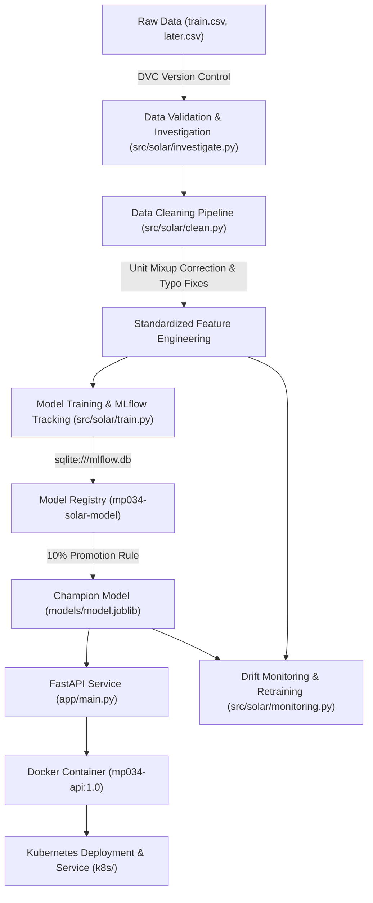

# Comprehensive MLOps Architecture & Pipeline Specification

**Group:** G087 | **Problem ID:** MP034 | **Faculty:** Dr. Gaurav Tripathi  
**Contributor:** Khushi Jangra (Data Lead)

This document provides architectural and technical documentation of the entire Rooftop Solar Energy pipeline for faculty evaluation and viva preparation.

---

## 1. System Architecture Diagram

---

## 2. Seven Data Quality Investigations & Resolution

1. **Target Leakage (`leaking_column`):** Inspected train schema against holdout schema; confirmed zero future variables present.
2. **Unit Mixup (`unit_mixup`):** New Colony `panel_area_m2` was recorded in $\text{cm}^2$ instead of $\text{m}^2$ (factor: $10,000$). Resolved via division by 10,000.
3. **Sentinels (`sentinel_value`):** No sentinel missing values (e.g. -999, 999).
4. **Duplicate Records (`duplicate_rows`):** Zero duplicate rows in original dataset.
5. **Sensor Freezing (`stuck_sensor`):** `cloud_cover_pct` froze at 49 from `2026-03-06` to `2026-03-19` (79 records).
6. **Target Typos (`target_typos`):** 9 records entered with extra zero (>100 kWh). Resolved by dividing by 10.
7. **Categorical Variants (`spelling_variants`):** `roof_type` contained whitespace and abbreviations; normalized to 3 canonical classes (`flat`, `tin`, `sloped`).

---

## 3. Retraining & 10% Model Promotion Rule

- **Baseline v1 MAE on evaluation check set:** `4.6934` kWh
- **Retrained v2 MAE on evaluation check set:** `4.1535` kWh
- **Relative Error Reduction:** $11.503\%$
- **Promotion Decision:** Promoted v2 to `@champion` since improvement $\ge 10\%$.
